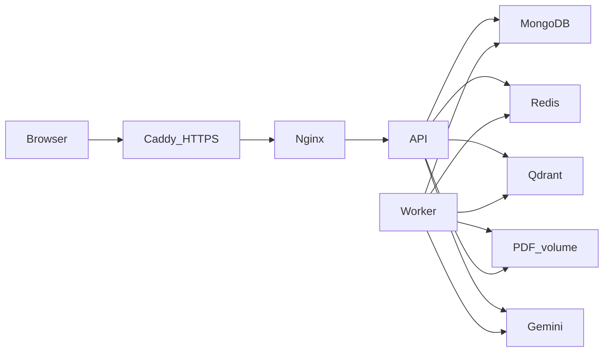

# Free single-VM deployment

This runs the application on one always-on virtual machine at no hosting cost. Docker Compose starts MongoDB, Redis, Qdrant, the API, the worker, and the web server. Caddy is the only process reachable from the internet. It obtains a TLS certificate and forwards traffic to nginx. PDF bytes stay on the shared `files` volume. The reranker stays off.

The local command `docker compose up --build` is unchanged and still serves `http://localhost:8080`. The public profile is a second Compose file, [infrastructure/docker-compose.public.yml](../infrastructure/docker-compose.public.yml).



## What you set up outside the repository

Keep secrets in `.env` on your PC and on the VM. Do not put them in git, logs, or chat.

- An Oracle Cloud Always Free account and an Ubuntu VM. The shape that fits this stack is Ampere A1, up to 4 OCPUs and 24 GB RAM, if your region still has that capacity. Read the current Always Free terms, including whether idle instances can be reclaimed and whether the identity check places a hold on a card. This guide does not promise that the account stays free.
- A DNS name pointed at the VM. Caddy cannot issue a certificate for a bare IP address. A name you already own, or a free name from DuckDNS, both work.
- A Gemini API key from [Google AI Studio](https://aistudio.google.com/). Read the current [Gemini API terms](https://ai.google.dev/gemini-api/terms) before uploading private PDFs. Free-tier data use and quotas change. This app sends document text and questions to Google when `EMBEDDING_PROVIDER` and `GENERATION_PROVIDER` are `gemini`.
- `GEMINI_GENERATION_MODEL` and `GEMINI_EMBEDDING_MODEL` set to model ids that this key can call. The defaults in [.env.example](../.env.example) are `gemini-3.8-flash` and `gemini-embedding-2`. Change them if the key does not offer those ids. `EMBEDDING_DIMENSIONS` must equal that embedding model's output size, or Qdrant rejects the vectors.
- A `BETTER_AUTH_SECRET` of at least 32 characters, generated on your machine.

## Create the VM

1. In Oracle Cloud, create a compute instance with Ubuntu 22.04 or 24.04, an Ampere A1 shape, and your SSH public key. Give it a public IPv4 address.
2. In the subnet security list, allow inbound TCP 22, 80, and 443. Do not open 27017, 6379, 6333, or 4000. The public Compose profile does not publish those ports.
3. Confirm the current Always Free quota before you raise CPU or RAM. Exceeding it can turn the instance into a paid one.

SSH in, then allow the same ports on the instance. Oracle Ubuntu images often reject traffic in iptables even after the security list allows it. Insert the accept rules and confirm they appear before any REJECT rule:

```bash
sudo iptables -I INPUT -p tcp --dport 80 -j ACCEPT
sudo iptables -I INPUT -p tcp --dport 443 -j ACCEPT
sudo iptables -L INPUT -n --line-numbers
sudo apt-get update
sudo apt-get install -y iptables-persistent
sudo netfilter-persistent save
```

Install Docker Engine with Compose 2.24 or newer. The public profile uses the `!override` tag, which older Compose versions reject. The current install steps are at [Install Docker Engine on Ubuntu](https://docs.docker.com/engine/install/ubuntu/). After install:

```bash
sudo usermod -aG docker "$USER"
docker compose version
```

Log out and back in so the `docker` group applies. `docker compose version` must report 2.24 or newer.

## Point DNS at the VM

Create an A record for the hostname you will use, for example `pdf.example.com`, with the VM's public IPv4 address. Wait until `dig +short pdf.example.com` prints that address. Caddy will fail to get a certificate until this resolves from the public internet.

## Configure and start

On the VM, from your home directory:

```bash
git clone https://github.com/AbhayRajYadav12/pdf.git
cd pdf
cp .env.example .env
chmod 600 .env
```

Edit `.env` and set at least:

```bash
BETTER_AUTH_SECRET=replace-with-32-or-more-characters
GEMINI_API_KEY=your-key
PUBLIC_ORIGIN=https://pdf.example.com
GEMINI_GENERATION_MODEL=the-model-id-your-key-can-call
GEMINI_EMBEDDING_MODEL=the-embedding-id-your-key-can-call
EMBEDDING_DIMENSIONS=768
```

`PUBLIC_ORIGIN` is the browser origin: `https`, the hostname, no path, and no trailing slash. `APP_ORIGIN` and `BETTER_AUTH_URL` are taken from it by the public profile. Production rejects state-changing requests whose `Origin` header does not match those values.

Generate the auth secret on the machine and write it into `.env` yourself. For example: `openssl rand -base64 32`.

Start from the repository root. `--project-directory .` makes Compose read `.env` from this directory. Without it, Compose uses `infrastructure/` as the project and does not see that file.

```bash
docker compose --project-directory . -f infrastructure/docker-compose.yml -f infrastructure/docker-compose.public.yml up -d --build
```

Caddy listens on 80 and 443. MongoDB, Redis, Qdrant, the API, and nginx have no host ports. The API and worker can still reach Gemini because they are attached to a network that has outbound access. The databases are on an internal network.

Memory limits in the public profile are 1 GB for MongoDB, 2 GB for Qdrant, 1 GB each for the API and worker, 256 MB for Redis and nginx, and 128 MB for Caddy. Ingestion concurrency is 1. The reranker is forced off.

Watch the logs until Caddy reports that it obtained a certificate:

```bash
docker compose --project-directory . -f infrastructure/docker-compose.yml -f infrastructure/docker-compose.public.yml logs -f caddy api worker
```

Open `https://pdf.example.com`.

## Check that it works

Use a small text PDF, not a scan, for the first check.

1. Register an account and sign in.
2. Upload the PDF and wait until its status is ready. The worker marks it ready only after Qdrant contains the expected number of sections.
3. Ask a question whose answer is in the PDF. The answer should include a citation. Open the citation and confirm the page.
4. Ask something the PDF does not contain. The answer should abstain rather than invent a source.
5. Delete the document.
6. Register a second account. It must not be able to open the first account's document. The API returns 404 for that request.

`GET /api/health` only means the API process is up. `GET /api/ready` checks MongoDB, Qdrant, and Redis.

## Backups

`scripts/backup.sh` writes three files into a timestamped directory:

- `mongo.archive` from `mongodump` of the `pdf_summary` database
- `files.tar.gz` from the PDF volume
- `qdrant.tar.gz` from the Qdrant storage volume, taken while Qdrant is stopped so the files are consistent
- `SHA256SUMS` for those three files

Qdrant is stopped only for the copy, then started again. Chat and indexing fail during that window.

```bash
sudo mkdir -p /var/backups/pdf-summary
sudo chown "$USER" /var/backups/pdf-summary
bash scripts/backup.sh
```

The script uses the public Compose files. For a local stack that is only the base file, set `BACKUP_COMPOSE=local`.

Copy each backup off the VM. A directory that remains on the VM disk is lost if the instance is deleted or the disk fails. `scp` to another machine is enough. Oracle Object Storage has its own Always Free allowance if you want the copy in the same cloud account. Confirm the current allowance before you rely on it.

A nightly cron entry, after the first manual backup succeeds:

```bash
0 3 * * * cd /home/ubuntu/pdf && BACKUP_DIR=/var/backups/pdf-summary /bin/bash scripts/backup.sh >> "$HOME/pdf-backup.log" 2>&1
```

Replace the home directory and repository path with the user and path you actually used.

## Restore drill

`scripts/restore.sh` checks `SHA256SUMS` when that file is present, stops the API, worker, and Qdrant, restores MongoDB with `mongorestore --drop`, replaces the PDF and Qdrant volumes, and starts those services again. MongoDB stays up during the restore. The stack must have been started at least once so the volumes exist.

```bash
bash scripts/restore.sh /var/backups/pdf-summary/20260101T000000Z
```

This repository does not record a completed restore drill. After the first real backup, restore it onto the VM, time the run, and confirm that a document from the backup opens and that `GET /api/ready` returns success. Write down that time. Until you do that, treat the scripts as unproven on your machine.

If a restore stops halfway, run the same command again. Do not keep serving traffic after a failed restore, because MongoDB, the PDF volume, and Qdrant can be out of step.

## What this deployment is not

- There is no email verification, password reset, or invitation email.
- Uploads are not scanned for malware.
- One API process holds live chat streams in memory. A second API instance would not see them. Do not scale the API service in this profile.
- The reranker is off. Answers use hybrid search and the relevance gate.
- There is no uptime guarantee. Confirm Oracle's current Always Free policy, including reclaim of idle instances.
- TLS certificates and backups are your responsibility to watch. Caddy renews certificates, but a DNS or firewall change can stop renewal.
- This is not a multi-machine or private-object-store deployment. The limits in [DEPLOYMENT.md](DEPLOYMENT.md) still apply if you later run more than one machine.

## Local check before the VM

On a PC with Docker Desktop, the base stack is still:

```bash
docker compose up --build
```

Open `http://localhost:8080`. With a real `GEMINI_API_KEY` in `.env`, upload one PDF and confirm it becomes ready and a cited answer returns.

Do not start the public profile on a PC that has no public DNS name. Caddy would try to obtain a certificate and fail. You can still check that the files parse. From the repository root, with dummy values that you do not use on the VM:

```bash
docker compose --project-directory . -f infrastructure/docker-compose.yml -f infrastructure/docker-compose.public.yml config
```

Set `PUBLIC_ORIGIN` and `BETTER_AUTH_SECRET` in the environment for that command. `config` fails closed when `PUBLIC_ORIGIN` is missing.

## Troubleshooting

- **Caddy logs an error about the certificate or ACME.** The hostname does not resolve to this VM yet, port 80 is blocked, or `PUBLIC_ORIGIN` is not `https://` plus that hostname. Fix DNS and the firewall, then restart Caddy. An IP address in `PUBLIC_ORIGIN` will not get a certificate.
- **The browser loads the site but sign-in returns 403.** `PUBLIC_ORIGIN` does not exactly match the origin in the browser, often because of a trailing slash, a path, or `http` instead of `https`.
- **A document stays queued.** The worker is not running or Redis is not reachable. Check `docker compose ... logs worker`.
- **A document never becomes ready.** Gemini rejected the key, the model id is not available on this key, or `EMBEDDING_DIMENSIONS` does not match the embedding model. The worker log has the error. The server does not invent vectors.
- **The worker exits with code 137 during a scanned PDF.** The 1 GB worker limit killed the process. On a 24 GB VM you can raise the worker `mem_limit` in [infrastructure/docker-compose.public.yml](../infrastructure/docker-compose.public.yml). Text-only PDFs should fit in 1 GB.
- **Chat tokens arrive in one burst at the end.** A proxy is buffering the stream. Caddy is set to flush every chunk, and nginx already disables proxy buffering for `/api/`. Confirm no extra proxy was added in front of Caddy.
- **`docker compose` rejects the public file.** Install Compose 2.24 or newer. The `!override` tag removes the localhost ports from the base file.
